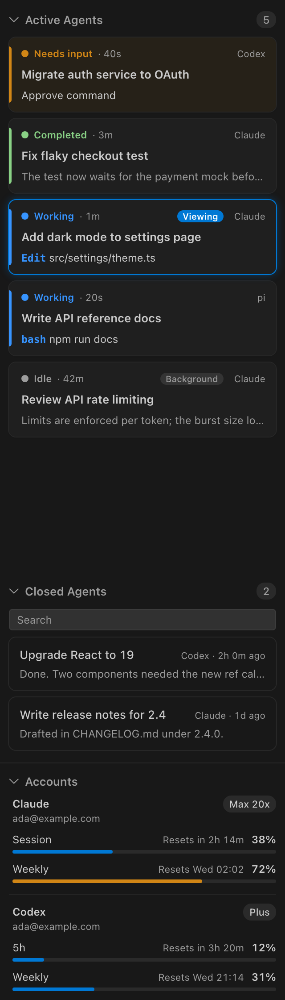

# Agents Deck

A VS Code sidebar panel for working with several coding agents at once: [Claude Code](https://docs.anthropic.com/en/docs/claude-code), [Codex CLI](https://github.com/openai/codex) and [pi](https://github.com/earendil-works/pi-coding-agent).



## Features

**Active Agents** lists the agents running in the current VS Code window, whichever harness they use:

- **Needs input**: the permission or answer it is waiting for, such as `Allow Bash?` or `Approve command`.
- **Completed**: finished a turn you haven't looked at yet. It turns **Idle** once you view it.
- **Working**: the tool it is running right now.
- **Idle**: the start of its last reply.

Agents are listed in that order of status, and within a status by when it last changed, most recent first.

The agent you are looking at is outlined in your theme's highlight colour and marked **Viewing**. Click any agent to switch to its terminal or chat tab, or to attach to a background session.

**Closed Agents** lists this project's recent sessions that are no longer running. Search them by title or reply, and click one to resume it in a new terminal (`claude --resume`, `codex resume` or `pi --session`).

**Accounts** shows each subscription (Claude, Codex) with its plan and usage limits. Limits more than an hour old are greyed out with the time they were last updated.

## Which sessions are shown

The panel shows the sessions that belong to this window, from three sources, each of which can be turned off:

| Source | What it covers |
| --- | --- |
| Terminal | Agents started in one of this window's terminals. |
| Extension | Agents running in an editor extension's chat panel in this window, such as the Claude Code extension. |
| Background | Claude Code background sessions (`/fork`, `--bg`) working in this window's folders. |

Extension chats are included by default, because they are the same kind of agent working on the same project. Agents in other windows and standalone apps (such as Codex Desktop) are left out, because you can't switch to them from this window.

## Settings

| Setting | Default | What it does |
| --- | --- | --- |
| `agentsDeck.harnesses.claude` / `.codex` / `.pi` | `true` | Show that harness's sessions and account. |
| `agentsDeck.sources.terminal` / `.extension` / `.background` | `true` | Show sessions from that source (see above). |
| `agentsDeck.closedSessions.maxAgeDays` | `7` | Days of finished sessions to list. `0` hides Closed Agents. |
| `agentsDeck.accounts.enabled` | `true` | Show the Accounts section. |
| `agentsDeck.refreshSeconds` | `10` | How often the panel re-reads agent status (2 to 60). The refresh button in the panel's title bar re-reads everything at once, including usage limits. |

## Install

Download the `.vsix` from the [latest release](https://github.com/sourava01/vscode-agents-deck/releases/latest), then:

```sh
code --install-extension agents-deck-0.1.0.vsix
```

Open the panel from the sparkles icon in the Activity Bar.

## Requirements

- VS Code 1.90 or later, on macOS or Linux. Agents are matched to terminals through the process tree from `ps`, which Windows doesn't have.
- At least one of Claude Code, Codex CLI or pi.

## How it works

The extension reads files the harnesses already keep on your machine. Its one exception: every 5 minutes, while the panel is open, it runs `claude` in SDK mode to ask for your Claude usage limits (no model call, no MCP servers, no saved session), which Claude Code then saves to `~/.claude.json`. It makes no network requests of its own.

| Harness | Running sessions | Transcripts and titles | Account and limits |
| --- | --- | --- | --- |
| Claude Code | `~/.claude/sessions/` | `~/.claude/projects/` | `~/.claude.json`, refreshed every 5 minutes as above |
| Codex CLI | `codex` processes, matched to their transcript by folder and start time | `~/.codex/sessions/`, `~/.codex/session_index.jsonl` | email and plan from the ID token in `~/.codex/auth.json` (no other token is read); limits from the latest session |
| pi | `pi` processes, matched the same way | `~/.pi/agent/sessions/` | none: pi uses your own provider keys |

Which terminal an agent runs in comes from its parent processes (`ps`), and Codex and pi working folders from `lsof`. A transcript is read in full once, then only what was added since.

Known limits:

- A session with no prompt yet shows as **New session** (pi writes its transcript only after the first prompt).
- pi doesn't record permission prompts, so a pi agent is never shown as **Needs input**.
- Codex limits appear only when Codex records them; some plans report none.

## Development

```sh
npm test          # runs the tests with Node's built-in test runner
npm run package   # builds the .vsix with @vscode/vsce
```

Each harness is one file in `src/harnesses/` with the same interface (`live`, `closed`, `account`), so adding another is a one-file change.

## License

[MIT](LICENSE)
